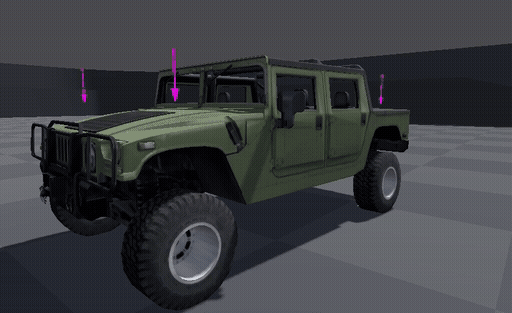

# Vehicle ShapeCast 3D
This is a simple custom implementation of vehicle and wheel physics based on the `ShapeCast3D` node. It implements a rigid wheel with a damper effect and largely corrects the problem of wheels falling through the collision surface. The vehicle body itself inherits the classic `RigidBody3D`. All code is written in C++ 17 and is provided as a shared library using `godot-cpp` and the built-in `Jolt` physics

<p align="center">
    
</p>

This physics was developed as a basis for my own game project, but I know many people are having trouble implementing vehicle wheel physics, so I decided to share the implementation with anyone who might need it

## Settings
For more stable physics of vehicles and their wheels, it is recommended to additionally configure the physics configurations for the physics engine
```code
[physics]
common/physics_ticks_per_second=90
common/physics_interpolation=true
jolt_physics_3d/simulation/velocity_steps=12
jolt_physics_3d/simulation/position_steps=6
jolt_physics_3d/simulation/penetration_slop=0.01
jolt_physics_3d/simulation/speculative_contact_distance=0.08
jolt_physics_3d/queries/use_enhanced_internal_edge_removal=true
jolt_physics_3d/collisions/collision_margin_fraction=0.05
```
You can simply copy these lines and paste them into your `project.godot` file in your project directory

## Building
Clone the latest version of `godot-cpp` into this directory
```bash
git clone https://github.com/godotengine/godot-cpp.git
```

Create a folder for the build
```bash
mkdir build && cd build
```

If you plan to build this project on more recent versions of Godot (for example 4.7) like me, i strongly recommend not to forget and explicitly specify the `GODOTCPP_API_VERSION` and `GODOTCPP_TARGET` parameters for the CMake build
```bash
cmake -DCMAKE_BUILD_TYPE=Release .. -DGODOTCPP_API_VERSION=4.7 -DGODOTCPP_TARGET=template_debug
```

Compile
```bash
cmake --build . -j4
```

## License
You can do whatever you want with this implementation, i dont care