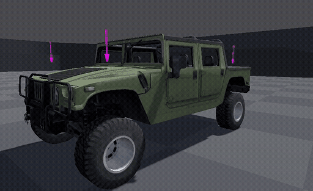

# Vehicle ShapeCast 3D
Это простая кастомная реализация физики транспорта и колеса основанная на `ShapeCast3D` узле, которая реализует твёрдое колесо с эффектом дампера и по большей степени исправляет проблему провала колеса под поверхность коллизии, само же тело транспорта наследует классический `RigidBody3D`. Весь код написан на C++ 17 и представляется в виде shared библиотеки используя `godot-cpp` и физический движок `Jolt`

<p align="center">
    
</p>

Данная физика была разработана как основа для собственного игрового проекта, но я знаю, что у большого количества людей возникают проблемы с реализацией физики колеса транспорта, по этому, я решил поделиться реализацией со всеми кому это будет необходимо

## Настройка
Для более стабильной физики транспорта и его колёс, рекомендуется дополнительно настроить физические конфигурации для физического движка
```code
[physics]
common/physics_ticks_per_second=90
common/physics_interpolation=true
jolt_physics_3d/simulation/velocity_steps=12
jolt_physics_3d/simulation/position_steps=6
jolt_physics_3d/simulation/penetration_slop=0.01
jolt_physics_3d/simulation/speculative_contact_distance=0.08
jolt_physics_3d/queries/use_enhanced_internal_edge_removal=true
jolt_physics_3d/collisions/collision_margin_fraction=0.05
```
Вы можете просто скопировать эти строки и вставить их в свой `project.godot` файл в директории вашего проекта

## Сборка
Клонируйте в эту директорию `godot-cpp` актуальной версии
```bash
git clone https://github.com/godotengine/godot-cpp.git
```

Создайте папку для сборки
```bash
mkdir build && cd build
```

Если вы планируете собирать этот проект на более свежие версии Godot (например 4.7) как и я, настоятельно рекомендую не забывать явно указывать параметры `GODOTCPP_API_VERSION` и `GODOTCPP_TARGET` для CMake сборки
```bash
cmake -DCMAKE_BUILD_TYPE=Release .. -DGODOTCPP_API_VERSION=4.7 -DGODOTCPP_TARGET=template_debug
```

Компиляция
```bash
cmake --build . -j4
```

## Лицензия
Вы можете делать с этой реализацией всё что хотите, мне всё равно